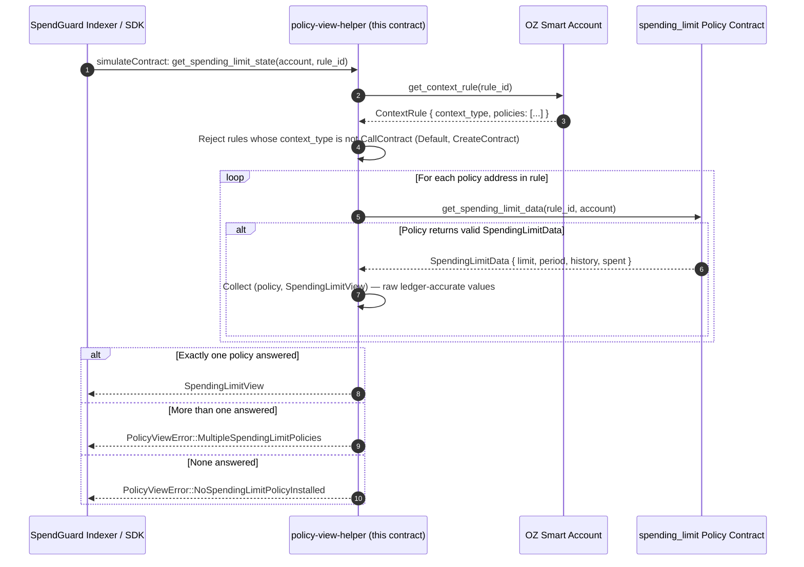

<div align="center">

# 🛡️ SpendGuard Contract

### Read-only Soroban `policy-view-helper` for OpenZeppelin smart-account spending limits

**The on-chain read half of SpendGuard. Zero custody. Zero writes. Zero signing.**

[](LICENSE)
[](https://github.com/Spendguard/spendguard-contract/actions/workflows/ci.yml)
[](rust-toolchain.toml)
[](Cargo.toml)
[](https://github.com/Spendguard/spendguard-contract/actions/workflows/ci.yml)
[](#how-it-works)

</div>

`policy-view-helper` is the smart-contract half of the SpendGuard ecosystem: a minimal, **read-only** Soroban contract that gives the [SpendGuard indexer](https://github.com/Spendguard/spendguard-app) a single clean, versioned interface for querying an [OpenZeppelin `stellar-accounts`](https://github.com/OpenZeppelin/stellar-contracts) smart account's declared `spending_limit` policy state — no hand-decoding of nested ledger entries, no stale caches, no wall-clock guesswork.

It **never holds funds, never writes state, and never sits in the payment path** — it only answers questions about public on-chain policy state.

---

## TL;DR

| `policy-view-helper` **is** | `policy-view-helper` **never** |
|---|---|
| ✅ A read-only on-chain query wrapper | ❌ Holds, moves, or signs for funds |
| ✅ A versioned public interface (`WASM_VERSION = 2`) | ❌ Writes storage or emits events |
| ✅ Two cross-contract reads per query | ❌ Blocks, freezes, or enforces anything |
| ✅ Raw ledger-accurate policy values | ❌ Converts ledgers to wall-clock on-chain |

If the helper is wrong or down, **no funds are at risk** — the real backstop is the on-chain policy enforcement it merely reflects.

---

## Why this matters

Smart accounts built on OpenZeppelin's framework declare spending-limit guardrails on-chain. But reading that state requires traversing complex nested structures (`ContextRule` → installed `Policy` contracts → `SpendingLimitData`) and the indexer would have to hand-decode multiple raw ledger entries per account per poll cycle.

`policy-view-helper` collapses that into one call:

- 📖 **Three functions, one purpose** — a version probe, the policy-state read, and the per-policy enumeration that read needs when a rule carries more than one limit.
- 🔗 **Cross-contract reads, zero state** — every query resolves addresses on-chain at call time; nothing is stored, cached, or remembered.
- 🧮 **Raw on-chain values** — returns precise stroop amounts and ledger sequences; wall-clock conversion is left to the indexer, which has access to Soroban RPC close-time data.
- 🔒 **Versioned for indexers** — `get_version` lets the [SpendGuard indexer](https://github.com/Spendguard/spendguard-app) fail loudly instead of silently mis-reading a changed API.

---

## How it works



### Public interface

| Function | Signature | Returns |
|---|---|---|
| `get_version` | `() -> u32` | `2` — WASM version marker for indexer compatibility checks |
| `get_spending_limit_state` | `(account: Address, context_rule_id: u32)` | `Result<SpendingLimitView, PolicyViewError>` |
| `get_spending_limit_policy_views` | `(account: Address, context_rule_id: u32)` | `Result<Vec<SpendingLimitPolicyView>, PolicyViewError>` |

The generated form of that table — the exact spec the WASM publishes, field order
and error numbers included — is committed at
[`specs/policy-view-helper.txt`](specs/policy-view-helper.txt) and CI rebuilds and
diffs it on every PR. Regenerate it with `make spec-file`.

The file is not decoration: the [app](https://github.com/Spendguard/spendguard-app) vendors a copy of it and its SDK test suite asserts, from that copy, the ScMap keys and types its decoder looks up, the `PolicyViewError` ordinals it maps to variant names, and the arity of each function it simulates. Change an entrypoint here without regenerating the file and CI fails here; change it and regenerate, and the app's pin fails there. Both halves of a broken contract are covered by a gate rather than by a release note.

### More than one `spending_limit` policy on a rule

An OZ context rule can carry several policies, and nothing stops two of them
being `spending_limit` with different caps. Until version 2 the helper returned
the **first policy that answered**, which is the account's storage order rather
than anything about the limits: with caps of 1 000 and 100 000 the dashboard
could render the loose one at 40 % used while the tight one was the limit that
actually blocked the next spend.

Version 2 splits the two questions:

- `get_spending_limit_policy_views` enumerates every responding policy, each
  labelled with the contract that reported it, so the caller can compute
  utilisation per limit and surface the worst.
- `get_spending_limit_state` keeps its shape — one `SpendingLimitView`, same
  fields — and answers `MultipleSpendingLimitPolicies` instead of choosing.
  Which limit "binds" depends on what the caller is asking (smallest remaining
  headroom and smallest cap disagree once the windows differ), and a read helper
  that picks silently is how a wrong number reaches a treasury dashboard.

Enumeration order follows the rule's own `policies` vector and is **not** a
ranking; every entry carries its address, so the order never has to be trusted
to be meaningful.

### `SpendingLimitView`

```rust
#[contracttype]
pub struct SpendingLimitView {
    /// Maximum amount (in stroops, 1 XLM = 10^7 stroops) in the rolling window.
    pub cap: i128,
    /// Rolling window length in ledgers (~5 s per ledger on Stellar).
    pub window_ledgers: u32,
    /// Total amount spent so far in the current rolling window.
    pub spent_in_window: i128,
    /// Ledger sequence of the earliest retained spending entry (0 = no history).
    pub window_started_ledger: u32,
}
```

### `SpendingLimitPolicyView`

```rust
#[contracttype]
pub struct SpendingLimitPolicyView {
    /// The policy contract that answered `get_spending_limit_data`.
    pub policy: Address,
    /// The state that policy reports.
    pub view: SpendingLimitView,
}
```

A struct rather than an `(Address, SpendingLimitView)` tuple, as #1's scope
suggested: the deployed spec then names both halves and a reader decodes by key
instead of by position. Decoding by position is how the app ended up looking for
`window_seconds` on a contract that emitted `window_ledgers`.

`window_started_ledger` is the **minimum** `ledger_sequence` in the policy's
spending history, not its first element. `stellar-accounts` 0.7.2 keeps that
vector oldest-first, so the two agree today; reading the minimum means the value
stays correct if the pinned dependency ever changes its storage layout.
`window_started_ledger_comes_from_the_real_policy_history` installs and enforces
through the real OZ policy (dev-dependency) to pin the ordering, and
`window_started_ledger_ignores_history_order` feeds an unsorted history through
the mirror types to pin the derivation.

### Errors

| Code | Error | Meaning |
|---|---|---|
| `1` | `NoSpendingLimitPolicyInstalled` | No policy on the rule answered `get_spending_limit_data` |
| `2` | `AccountNotFound` | The smart account rejected the query (rule missing, wrong address) |
| `3` | `UnsupportedContextType` | The context rule targets a non-transfer context, where `spending_limit` never applies |
| `4` | `MultipleSpendingLimitPolicies` | More than one policy answered, so no single view describes the limit — only `get_spending_limit_state` returns this |

Every row is named by a test. `policy_view_error(..)` in `test.rs` unwraps the four
layers of the generated `try_` client's result, so a test fails when the *wrong*
variant comes back — not only when the call fails — which is the distinction that
let #1 stay green behind `assert!(result.is_err())`.

---

## Security posture

SpendGuard's whole design is built on a single principle: **the least powerful tool that solves the problem.** This contract is the extreme version of that.

- 🔒 **Read-only by construction** — zero storage writes, zero state mutations, zero events emitted (verifiable by reading the source)
- 🔑 **Zero custody** — never holds, moves, or signs for funds
- 👀 **Public data only** — every input and output is public on-chain state; no secrets anywhere in the execution path
- 🧮 **No floats, no `unwrap` in production** — `i128` integer math throughout, all errors propagated explicitly
- 📖 See [SECURITY.md](./SECURITY.md) for the full scope, audit status, and disclosure process

---

## Quick start

```bash
git clone https://github.com/Spendguard/spendguard-contract.git
cd spendguard-contract
make build             # → target/wasm32v1-none/release/policy_view_helper.wasm
make check             # 20 tests + clippy -D warnings — the first CI job
make spec-check        # the built WASM still publishes specs/policy-view-helper.txt
cargo test --workspace # if you would rather not go through make
```

**Requirements:** Rust `stable` (pinned in `rust-toolchain.toml` with the `wasm32v1-none` target and `rustfmt`/`clippy`/`rust-src` components) and the [Soroban CLI](https://soroban.stellar.org/docs/cli) ≥ 25.2 — though `make spec-file`/`spec-check` compare CLI-formatted text, so CI installs the version pinned in the Makefile (`PINNED_STELLAR_CLI`) and expects that one locally too. See [Build & deploy](#build--deploy) for why `make build` wraps `stellar contract build` rather than `cargo build`.

### Deployed instances

| Network | Contract ID | `get_version` | WASM sha256 | Status |
|---|---|---|---|---|
| **Stellar Testnet** | `CCAM4NRAUB6SO3XLL2SRZQEHSOUYQGDKGNPCUIQ5KKI2S6QKWC2VN6NX` | `1` | `ff125048e43d9e0f1139b3b89a348ac3916342cf9825b0fbc112d68b17735139` | Active |

This is the ID the [SpendGuard app](https://github.com/Spendguard/spendguard-app) reads via `POLICY_VIEW_HELPER_CONTRACT_ID`. Neither row is a claim you have to take on faith: `make verify` downloads the WASM living at that address, hashes it, and diffs the interface it publishes against the interface of this checkout.

On current `master`, `make verify` prints:

```
built       6190f5a1c94d866b2b72b0f4d841ca2ca609a29519afb33d17d573505b52d876
deployed    ff125048e43d9e0f1139b3b89a348ac3916342cf9825b0fbc112d68b17735139
README says ff125048e43d9e0f1139b3b89a348ac3916342cf9825b0fbc112d68b17735139
DIFFERS: the published instance was built from other source — see README 'Deployed instances'
SPEC: DIFFERENT — diff target/spec.built.txt against target/spec.deployed.txt; the deployed instance is not the contract this README documents
```

and that diff is exactly the three things #5 added — `get_spending_limit_policy_views`, the `SpendingLimitPolicyView` struct, and `MultipleSpendingLimitPolicies = 4`. So the live address runs the **pre-#5** helper: no enumeration, no refusal, `get_spending_limit_state` still returns the first policy that answered. `get_version` returning `1` says the same thing from inside the contract, and catching that discrepancy is precisely why the app probes the version instead of assuming it.

Two things that check does **not** establish, stated plainly rather than glossed:

- **The published bytes are not reproducible from this history.** `b74a40d` — the commit whose spec matches the deployed instance exactly — rebuilds to `f5167a00513568d82c417c3bf93e06e3355aea893789272bd0522262163d1756`, not `ff125048…`, with the toolchain this repo pins. No commit here has been shown to produce the deployed WASM, so the hash is a fact about the chain rather than a link back to source: what stays checkable is the *interface*, via `make spec-deployed` against `make interface` at any commit.
- **#2 and #6 are invisible to a spec diff.** Both changed the body of `get_spending_limit_state` without touching a signature, so no comparison of interfaces can say whether the deployed instance carries those fixes. Until a version 2 deploy happens, the honest description of the live testnet helper is "pre-#5 API, fix history unknown from the chain".

What *is* reproducible is `master` itself, and CI now proves it rather than asserting it: the **Build WASM & check pinned interface** job compiles on a GitHub runner with the pinned toolchain and the pinned stellar-cli, prints the sha256 into the run summary, and uploads `policy_view_helper.wasm`. Its first run produced `6190f5a1c94d866b2b72b0f4d841ca2ca609a29519afb33d17d573505b52d876` — the same hash as `make build` on the dev machine that wrote this — so a redeploy's artefact can be tied to a commit by anyone, not only by whoever held the keys.

---

## Build & deploy

Run from the repo root. `make` with no target lists every target; `make versions` prints the stellar-cli, `rustc` and `cargo` a build will actually use.

```bash
make build        # → target/wasm32v1-none/release/policy_view_helper.wasm
make check        # cargo test --workspace + clippy --all-targets -- -D warnings
make spec-check   # the committed interface still matches the built WASM
make hash         # sha256 of the artefact — this is the on-chain WASM id
make interface    # the contract spec this checkout publishes
make verify       # build + fetch, then compare hashes and specs against the chain
make deploy SOURCE_ACCOUNT=<stellar key alias>
make clean
```

`make check` and `make spec-check` are the two CI jobs; see [Scripts & CI](#scripts--ci).

### `stellar contract build` is the only build that works here

The crate enables the SDK's `experimental_spec_shaking_v2` feature, and only the Soroban CLI drives it correctly:

| What you might reach for | What happens |
|---|---|
| `cargo build --release --target wasm32v1-none` | Fails by design: *"soroban-sdk feature 'experimental_spec_shaking_v2' requires building with `stellar contract build` from stellar-cli v25.2.0 or newer"* |
| `cargo build --release --target wasm32-unknown-unknown` | Rejected by Rust ≥ 1.82; the v1 target is `wasm32v1-none` |
| `stellar contract optimize` | Deprecated in stellar-cli 25+; `contract build` optimizes by default (`--optimize` is on), so `make optimize` is an alias that prints where the artefact already is |
| `stellar contract build` | Works, and is what `make build` runs |

`rust-toolchain.toml` pins the toolchain and the `wasm32v1-none` target, so `rustup` installs what it needs on the first `cargo`/`make` invocation. The package is `policy-view-helper` but the cdylib is `policy_view_helper.wasm` — cargo underscores the crate name in the artefact, which is why both spellings appear in the `Makefile`.

### Environment

Almost everything is a `?=`-defaulted make variable, so it can be set on the command line or in the environment. The names match the app repo's `.env`.

| Variable | Default | Meaning |
|---|---|---|
| `SOROBAN_RPC_URL` | `https://soroban-testnet.stellar.org` | What `fetch`, `verify` and `deploy` talk to |
| `NETWORK_PASSPHRASE` | `Test SDF Network ; September 2015` | Must match the network above |
| `NETWORK` | `testnet` | Passed to `stellar contract deploy`; anything else is treated as publishing |
| `CONTRACT_ID` | the instance in the table above | What `fetch`, `spec-deployed` and `verify` read |
| `EXPECTED_WASM_HASH` | the sha256 in the table above | `verify` fails if the chain disagrees with the README |
| `SPEC_FILE` | `specs/policy-view-helper.txt` | Where the committed interface lives; `spec-file` writes it, `spec-check` and CI read it |
| `SOURCE_ACCOUNT` | *unset* | A key alias already in `stellar keys ls`. `deploy` refuses to run without it |
| `ALLOW_MAINNET` | *unset* | Must be `1` before `NETWORK` may be anything but `testnet` |

One variable is deliberately *not* overridable: `PINNED_STELLAR_CLI := 28.1.0`. CI installs that exact release, and `spec-check` names it in its failure message, because the committed interface is the CLI's formatting of the spec — if the formatter could be swapped per run, the gate would pass or fail depending on the machine.

`SOURCE_ACCOUNT` names a key the Soroban CLI holds in its own config (`stellar keys generate <name>` then `stellar keys fund <name>` for a throwaway testnet account). A secret never belongs in this file, in a target, in a shell history line that gets pasted into an issue, or in a commit — `--auto-sign` with an alias is the whole point.

### Deploy is guarded, on purpose

A read-only helper is still the address the indexer is told to trust, so `make deploy` makes publishing take two deliberate choices:

- No `SOURCE_ACCOUNT` → it stops and says so, rather than guessing which account should pay.
- `NETWORK` anything other than `testnet` → it refuses unless `ALLOW_MAINNET=1` is also passed, and then prints what it is about to do and waits 5 seconds.

### After a deploy that you intend to publish

`make deploy` prints the new contract ID. The repo then has three records to bring in line, in one PR:

1. `CONTRACT_ID` and `EXPECTED_WASM_HASH` in the `Makefile`.
2. The **Deployed instances** table above — contract ID, `get_version`, and the sha256 from `make fetch-hash`.
3. The app's `POLICY_VIEW_HELPER_CONTRACT_ID`, or the testnet address the indexer is configured with.

`make verify` is the check that all three agree: it should print `MATCH: the published instance is this checkout` and `SPEC: identical`. Anything else means the README describes a contract that is not the one running.

---


## Architecture

```
spendguard-contract/
├── contracts/policy-view-helper/   # The single Soroban contract
│   ├── src/
│   │   ├── lib.rs                  # #[contract] entry point + public interface
│   │   ├── read.rs                 # Cross-contract query implementation
│   │   ├── types.rs                # SpendingLimitView, errors, OZ mirror types
│   │   └── test.rs                 # 20 tests: real-OZ round-trips, one
│   │                               #   specific PolicyViewError per failure
│   │                               #   mode, window-order driven by the policy
│   └── test_snapshots/             # Soroban snapshot fixtures
├── specs/
│   └── policy-view-helper.txt      # The interface the built WASM publishes, CI-checked
├── .github/workflows/ci.yml        # Test & Clippy, plus WASM build + pinned interface
├── Makefile                        # build / check / verify / spec-check / guarded deploy
├── rust-toolchain.toml             # Pinned Rust stable + wasm32v1-none target
├── CONTRIBUTING.md · SECURITY.md · drips.json · LICENSE
└── Cargo.toml                      # Workspace root manifest
```

### Technical stack

| Component | Version / Target |
|---|---|
| Rust Edition | 2021 |
| Soroban SDK | `26.1.0` (`experimental_spec_shaking_v2`) |
| OpenZeppelin `stellar-accounts` | `=0.7.2` (pinned dev-dependency) |
| Soroban Test Helpers | `0.2.4` |
| Compilation Target | `wasm32v1-none` |
| Release profile | `opt-level = "z"`, `lto = true`, `overflow-checks = true`, `panic = "abort"` |

The `stellar-accounts` dependency is **pinned** and only used in tests — the production contract carries its own mirror types and verifies they still decode real OZ data via `oz_serialization_compat` round-trip tests.

---

## Scripts & CI

| Command | Description |
|---|---|
| `make build` (`stellar contract build`) | Builds the optimized WASM to `target/wasm32v1-none/release/policy_view_helper.wasm` |
| `make check` / `cargo test --workspace` | Runs the 20-test suite (positive, negative — each asserting a specific `PolicyViewError` — OZ compatibility, window-start ordering, and multi-policy cases) |
| `cargo clippy --workspace --all-targets -- -D warnings` | Lints with warnings denied (CI gate) |
| `make hash` / `make interface` | The sha256 and the spec of the artefact this checkout produces |
| `make spec-file` / `make spec-check` | Writes / verifies `specs/policy-view-helper.txt`, the interface committed next to the source |
| `make fetch` / `make fetch-hash` / `make spec-deployed` | The same three readings of the instance that is actually deployed |
| `make verify` | Compares the two, and fails if the chain no longer matches the hash recorded in the README |
| `make deploy SOURCE_ACCOUNT=<alias>` | Testnet deploy; refuses to guess an account and refuses any network but `testnet` without `ALLOW_MAINNET=1` |

CI (GitHub Actions) runs two jobs on every push and pull request to `master`:

- **Test & Clippy** — `cargo test --workspace`, then clippy with warnings denied.
- **Build WASM & check pinned interface** — installs the stellar-cli the Makefile
  pins (`PINNED_STELLAR_CLI`), builds the WASM, fails when
  `specs/policy-view-helper.txt` no longer describes it, and uploads the built
  artefact with its sha256 in the job summary.

The second job exists because the app decodes this contract's responses: an
interface change that only appears when the indexer breaks is a change that got
past review. Pinning the CLI version matters for the diff — the committed file is
the CLI's *formatting* of the spec, so a formatter upgrade can produce a diff with
no API change; `make spec-check` says so and prints both versions.

`make verify` is still not a CI step: it needs a testnet RPC connection, and a job
that would silently pass by skipping its network calls documents less than a
human/agent step that either runs or reports the failure.

---

## Known limitations (honest)

1. **`spending_limit` policy type only** — the helper reads the `spending_limit` policy installed on a transfer-context rule. `simple_threshold` and `weighted_threshold` policies are not queried (yet), and OZ scopes `spending_limit` to transfer contexts by design — an upstream constraint, not a SpendGuard one.
2. **Ledger windows, not wall-clock** — all window fields are ledger sequences; the indexer is responsible for converting them to timestamps using Soroban RPC close-time data.
3. **Mirror types must track OpenZeppelin** — the production mirror types are verified against `stellar-accounts` 0.7.2; an OZ upgrade requires re-running the compatibility tests and the real-policy window-order test (which asserts the retained history order directly) before the pin moves.
4. **No events emitted** — indexing still relies on the OZ contracts' own `transfer` / `spending_limit_enforced` events; this contract is query-only.
5. **The live testnet instance predates #5, and its bytes are not reproducible from this repo** — `make verify` proves both, and [Build & deploy](#build--deploy) explains what a redeploy would cost (a new address, and the app's `POLICY_VIEW_HELPER_CONTRACT_ID` with it). Publishing v2 is one guarded command, not an undocumented incantation any more; it has not been run because the deployed address is shared state.

---

## Roadmap

- 🧩 Support additional OZ policy types (`simple_threshold`, `weighted_threshold`)
- 🌐 Mainnet deployment alongside the app's live-testnet flow
- ⚡ Batch / multi-rule convenience queries for the indexer
- 🔐 Independent audit of the narrow cross-contract read path

---

## Changelog

### `WASM_VERSION = 2` — multi-policy rules (#5)

Breaking for a rule that carries more than one `spending_limit` policy; a rule
with one policy behaves exactly as before.

| Change | What the indexer must do |
|---|---|
| `get_spending_limit_state` returns `MultipleSpendingLimitPolicies` (`#4`) instead of the first answering policy | Treat `#4` as *ambiguous*, never as *no policy*. On the deployed v1 contract it cannot appear; on v2 a caller that maps every `Error(Contract, #N)` to "nothing to show" would render an account with two limits as having none |
| New `get_spending_limit_policy_views` → `Vec<SpendingLimitPolicyView>` | Use it to compute utilisation per policy and surface the tightest; entries carry `policy: Address` so the enumeration order never has to be trusted |
| `SpendingLimitView` fields unchanged (`cap`, `window_ledgers`, `spent_in_window`, `window_started_ledger`) | Existing decoding keeps working |
| `get_version` → `2` | Probe it before reading, and fail loudly on a version the decoder has not been checked against |

### `WASM_VERSION = 1`

`get_spending_limit_state` + `get_version`, reading one `spending_limit` policy
per context rule. The window fields have been ledger-native since commit
`b4bd728`, which removed the invented 5 s-per-ledger conversion the first draft
returned.

---

## Contributing

Contributors are welcome — and rewarded. This contract is a great **Drips-wave contribution target**: ~300 lines of Rust, a pinned dependency, and a test suite that encodes the entire contract surface.

- 🎯 Start with the issues labelled **good first issue**
- 📖 Read [CONTRIBUTING.md](./CONTRIBUTING.md) — Conventional Commits, no `unwrap` outside tests, positive + negative test required per function
- 🐛 Security-sensitive bugs go through [SECURITY.md](./SECURITY.md)
- 🧪 `cargo test --workspace` before opening a PR

---

## License

[MIT](LICENSE) © SpendGuard Contributors
