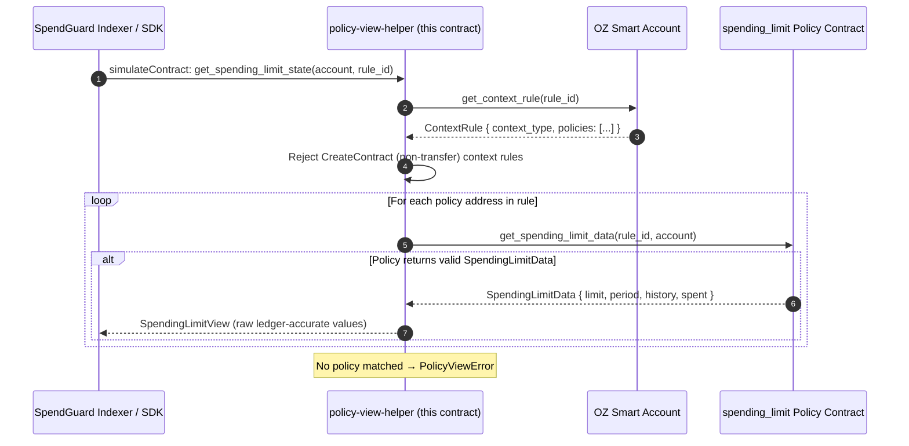

<div align="center">

# 🛡️ SpendGuard Contract

### Read-only Soroban `policy-view-helper` for OpenZeppelin smart-account spending limits

**The on-chain read half of SpendGuard. Zero custody. Zero writes. Zero signing.**

[](LICENSE)
[](https://github.com/Spendguard/spendguard-contract/actions/workflows/ci.yml)
[](rust-toolchain.toml)
[](Cargo.toml)
[](https://github.com/Spendguard/spendguard-contract/actions/workflows/ci.yml)
[](#how-it-works)

</div>

`policy-view-helper` is the smart-contract half of the SpendGuard ecosystem: a minimal, **read-only** Soroban contract that gives the [SpendGuard indexer](https://github.com/Spendguard/spendguard-app) a single clean, versioned interface for querying an [OpenZeppelin `stellar-accounts`](https://github.com/OpenZeppelin/stellar-contracts) smart account's declared `spending_limit` policy state — no hand-decoding of nested ledger entries, no stale caches, no wall-clock guesswork.

It **never holds funds, never writes state, and never sits in the payment path** — it only answers questions about public on-chain policy state.

---

## TL;DR

| `policy-view-helper` **is** | `policy-view-helper` **never** |
|---|---|
| ✅ A read-only on-chain query wrapper | ❌ Holds, moves, or signs for funds |
| ✅ A versioned public interface (`WASM_VERSION = 1`) | ❌ Writes storage or emits events |
| ✅ Two cross-contract reads per query | ❌ Blocks, freezes, or enforces anything |
| ✅ Raw ledger-accurate policy values | ❌ Converts ledgers to wall-clock on-chain |

If the helper is wrong or down, **no funds are at risk** — the real backstop is the on-chain policy enforcement it merely reflects.

---

## Why this matters

Smart accounts built on OpenZeppelin's framework declare spending-limit guardrails on-chain. But reading that state requires traversing complex nested structures (`ContextRule` → installed `Policy` contracts → `SpendingLimitData`) and the indexer would have to hand-decode multiple raw ledger entries per account per poll cycle.

`policy-view-helper` collapses that into one call:

- 📖 **Two functions, one purpose** — a version probe and a policy-state read, nothing else.
- 🔗 **Cross-contract reads, zero state** — every query resolves addresses on-chain at call time; nothing is stored, cached, or remembered.
- 🧮 **Raw on-chain values** — returns precise stroop amounts and ledger sequences; wall-clock conversion is left to the indexer, which has access to Soroban RPC close-time data.
- 🔒 **Versioned for indexers** — `get_version` lets the [SpendGuard indexer](https://github.com/Spendguard/spendguard-app) fail loudly instead of silently mis-reading a changed API.

---

## How it works



### Public interface

| Function | Signature | Returns |
|---|---|---|
| `get_version` | `() -> u32` | `1` — WASM version marker for indexer compatibility checks |
| `get_spending_limit_state` | `(account: Address, context_rule_id: u32)` | `Result<SpendingLimitView, PolicyViewError>` |

### `SpendingLimitView`

```rust
#[contracttype]
pub struct SpendingLimitView {
    /// Maximum amount (in stroops, 1 XLM = 10^7 stroops) in the rolling window.
    pub cap: i128,
    /// Rolling window length in ledgers (~5 s per ledger on Stellar).
    pub window_ledgers: u32,
    /// Total amount spent so far in the current rolling window.
    pub spent_in_window: i128,
    /// Ledger sequence of the earliest retained spending entry (0 = no history).
    pub window_started_ledger: u32,
}
```

### Errors

| Code | Error | Meaning |
|---|---|---|
| `1` | `NoSpendingLimitPolicyInstalled` | No policy on the rule answered `get_spending_limit_data` |
| `2` | `AccountNotFound` | The smart account rejected the query (rule missing, wrong address) |
| `3` | `UnsupportedContextType` | The context rule targets a non-transfer context, where `spending_limit` never applies |

---

## Security posture

SpendGuard's whole design is built on a single principle: **the least powerful tool that solves the problem.** This contract is the extreme version of that.

- 🔒 **Read-only by construction** — zero storage writes, zero state mutations, zero events emitted (verifiable by reading the source)
- 🔑 **Zero custody** — never holds, moves, or signs for funds
- 👀 **Public data only** — every input and output is public on-chain state; no secrets anywhere in the execution path
- 🧮 **No floats, no `unwrap` in production** — `i128` integer math throughout, all errors propagated explicitly
- 📖 See [SECURITY.md](./SECURITY.md) for the full scope, audit status, and disclosure process

---

## Quick start

```bash
git clone https://github.com/Spendguard/spendguard-contract.git
cd spendguard-contract
stellar contract build     # → target/wasm32v1-none/release/policy_view_helper.wasm
cargo test --workspace     # 9 tests: 6 behavior + 3 OZ serialization-compat
```

**Requirements:** Rust `stable` (pinned in `rust-toolchain.toml` with the `wasm32v1-none` target and `rustfmt`/`clippy`/`rust-src` components) and the [Soroban CLI](https://soroban.stellar.org/docs/cli).

### Deployed instances

| Network | Contract ID | Status |
|---|---|---|
| **Stellar Testnet** | `CCAM4NRAUB6SO3XLL2SRZQEHSOUYQGDKGNPCUIQ5KKI2S6QKWC2VN6NX` | Active |

This is the ID the [SpendGuard app](https://github.com/Spendguard/spendguard-app) reads via `POLICY_VIEW_HELPER_CONTRACT_ID`.

---

## Architecture

```
spendguard-contract/
├── contracts/policy-view-helper/   # The single Soroban contract
│   ├── src/
│   │   ├── lib.rs                  # #[contract] entry point + public interface
│   │   ├── read.rs                 # Cross-contract query implementation
│   │   ├── types.rs                # SpendingLimitView, errors, OZ mirror types
│   │   └── test.rs                 # 9 tests incl. real-OZ serialization round-trips
│   └── test_snapshots/             # Soroban snapshot fixtures
├── .github/workflows/ci.yml        # Test & Clippy on every push/PR to master
├── rust-toolchain.toml             # Pinned Rust stable + wasm32v1-none target
├── CONTRIBUTING.md · SECURITY.md · drips.json · LICENSE
└── Cargo.toml                      # Workspace root manifest
```

### Technical stack

| Component | Version / Target |
|---|---|
| Rust Edition | 2021 |
| Soroban SDK | `26.1.0` (`experimental_spec_shaking_v2`) |
| OpenZeppelin `stellar-accounts` | `=0.7.2` (pinned dev-dependency) |
| Soroban Test Helpers | `0.2.4` |
| Compilation Target | `wasm32v1-none` |
| Release profile | `opt-level = "z"`, `lto = true`, `overflow-checks = true`, `panic = "abort"` |

The `stellar-accounts` dependency is **pinned** and only used in tests — the production contract carries its own mirror types and verifies they still decode real OZ data via `oz_serialization_compat` round-trip tests.

---

## Scripts & CI

| Command | Description |
|---|---|
| `stellar contract build` | Builds the optimized WASM to `target/wasm32v1-none/release/policy_view_helper.wasm` |
| `cargo test --workspace` | Runs the 9-test suite (positive, negative, and OZ compatibility cases) |
| `cargo clippy --workspace --all-targets -- -D warnings` | Lints with warnings denied (CI gate) |

CI (GitHub Actions) runs **Test & Clippy** on every push and pull request to `master`.

---

## Known limitations (honest)

1. **`spending_limit` policy type only** — the helper reads the `spending_limit` policy installed on a transfer-context rule. `simple_threshold` and `weighted_threshold` policies are not queried (yet), and OZ scopes `spending_limit` to transfer contexts by design — an upstream constraint, not a SpendGuard one.
2. **Ledger windows, not wall-clock** — all window fields are ledger sequences; the indexer is responsible for converting them to timestamps using Soroban RPC close-time data.
3. **Mirror types must track OpenZeppelin** — the production mirror types are verified against `stellar-accounts` 0.7.2; an OZ upgrade requires re-running the compatibility tests before the pin moves.
4. **No events emitted** — indexing still relies on the OZ contracts' own `transfer` / `spending_limit_enforced` events; this contract is query-only.

---

## Roadmap

- 🧩 Support additional OZ policy types (`simple_threshold`, `weighted_threshold`)
- 🌐 Mainnet deployment alongside the app's live-testnet flow
- ⚡ Batch / multi-rule convenience queries for the indexer
- 🔐 Independent audit of the narrow cross-contract read path

---

## Contributing

Contributors are welcome — and rewarded. This contract is a great **Drips-wave contribution target**: ~300 lines of Rust, a pinned dependency, and a test suite that encodes the entire contract surface.

- 🎯 Start with the issues labelled **good first issue**
- 📖 Read [CONTRIBUTING.md](./CONTRIBUTING.md) — Conventional Commits, no `unwrap` outside tests, positive + negative test required per function
- 🐛 Security-sensitive bugs go through [SECURITY.md](./SECURITY.md)
- 🧪 `cargo test --workspace` before opening a PR

---

## License

[MIT](LICENSE) © SpendGuard Contributors
